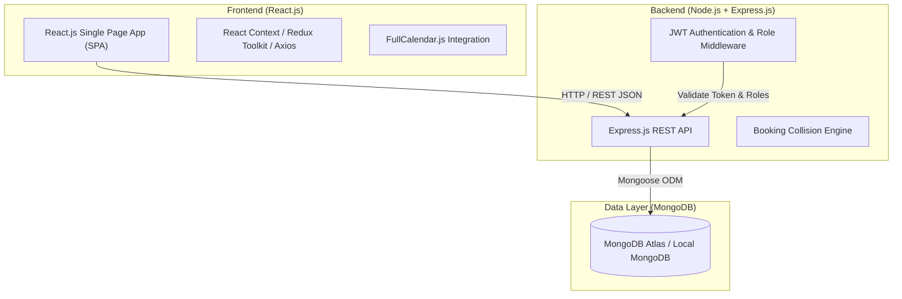
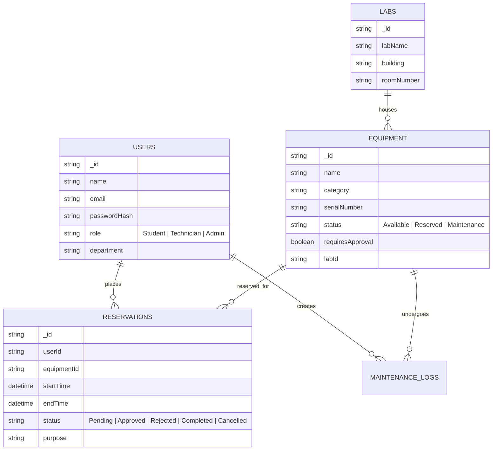

# EE4207 – Web Application Development
## Project Topic Submission & Technical Proposal

---

### **1. Basic Project Information**

| Parameter | Details |
| :--- | :--- |
| **Module Code & Name** | **EE4207 – Web Application Development** |
| **Assessment Type** | Web Application Project + Viva / Project Evaluation |
| **Project Title** | **Smart Lab Equipment Reservation & Management System (LabReserve)** |
| **Domain** | MERN Stack Web Development / Academic Infrastructure Management |
| **Proposed Tech Stack** | **MongoDB, Express.js, React.js, Node.js (MERN Stack)** |

---

### **2. Project Abstract & Background**

In academic and technical institutions, specialized laboratory equipment (e.g., Digital Storage Oscilloscopes, Spectrum Analyzers, 3D Printers, High-Performance Computing Workstations, and Spectrophotometers) are shared resources in high demand. Traditional reservation methods—such as manual logbooks, email requests, or physical signup sheets—often lead to double-bookings, scheduling conflicts, lack of visibility into real-time equipment status, and unmonitored equipment downtime.

**LabReserve** is a modern, responsive MERN stack web application designed to digitize and automate the reservation, scheduling, and management of university laboratory equipment. The platform provides students and researchers with a seamless self-service booking calendar while equipping lab technicians and department administrators with tools for access control, approval workflows, usage tracking, and maintenance scheduling.

---

### **3. Problem Statement & Motivation**

1. **Scheduling Collisions & Double Bookings**: Lack of real-time slot synchronization results in multiple students showing up for the same equipment.
2. **Inefficient Usage & Fair Allocation**: Without maximum usage caps per user, certain students monopolize high-demand machinery.
3. **Restricted Equipment Safety & Authorization**: Certain advanced machinery requires safety clearance or supervisor approval before operation.
4. **Maintenance & Downtime Tracking**: Technicians struggle to log and communicate when equipment is under repair or scheduled for calibration.

---

### **4. System Architecture & Tech Stack**

The project will be built using the MERN stack with a modular, RESTful API architecture for seamless frontend-backend communication.

#### **Technology Stack Details**:
- **Frontend**:
  - **Framework**: React.js (Component-driven SPA architecture)
  - **Styling**: Tailwind CSS / Bootstrap 5 (Responsive and mobile-friendly design)
  - **State & HTTP**: Axios, React Context API / Redux Toolkit
  - **Interactivity**: FullCalendar.js, React-Hook-Form, Lucide Icons
- **Backend**:
  - **Runtime**: Node.js
  - **Framework**: Express.js (RESTful API architecture)
  - **Authentication**: JSON Web Tokens (JWT) and bcrypt.js password hashing
  - **Validation & Logic**: Express-validator, slot conflict detection logic, role-based access control
- **Database**:
  - **Database System**: MongoDB with Mongoose ODM
- **Deployment & Hosting (Target)**:
  - **Frontend**: Vercel / Netlify
  - **Backend**: Render / Railway / Cyclic
  - **Database**: MongoDB Atlas

---

### **5. Key System Features & Requirements**

#### **A. User Authentication & Role-Based Access Control (RBAC)**
- **Student / Researcher**: Can browse catalog, check availability, place booking requests, and manage personal bookings.
- **Lab Technician / Supervisor**: Can approve/reject bookings, mark equipment as "Under Maintenance", log usage, and manage lab slots.
- **System Administrator**: Can manage user permissions, register new lab equipment, set lab operating hours, and view system analytics.

#### **B. Equipment Catalog & Search Engine**
- Filter equipment by **Lab Location**, **Category** (Electronics, Mechanical, Chemical, Computing), **Availability**, and **Required Certification**.
- Detailed Equipment Specifications Page (model, specs, safety rules, downloadable user manual/PDFs).

#### **C. Interactive Reservation & Scheduling Engine**
- **Calendar Grid View**: Daily, weekly, and monthly availability views.
- **Conflict Prevention Engine**: Real-time slot validation preventing overlapping reservations for the same machine.
- **Usage Quotas**: Weekly booking limit per student to guarantee equitable resource access.
- **Cooldown & Setup Buffers**: Automated 15-minute buffer between consecutive bookings for cleaning/calibration.

#### **D. Approval & Workflow Management**
- **Auto-Approval**: Enabled for general-purpose equipment (e.g., standard multimeter, basic workstation).
- **Manual Approval Workflow**: Required for high-risk/high-value equipment, sending a pending request notification to the lab supervisor.

#### **E. Dashboard & Analytics**
- Real-time statistics: Total Active Reservations, Equipment Utilization Rate (%), Maintenance Status, and Peak Hours Heatmap.

---

### **6. Database Schema Overview (Key Entities)**

---

### **7. Implementation Plan & Milestones**

| Phase | Duration | Tasks |
| :--- | :--- | :--- |
| **Phase 1: Requirements & Design** | Week 1 - 2 | Wireframing UI, DB Schema design, API endpoint specification. |
| **Phase 2: Backend Development** | Week 3 - 4 | Express setup, MongoDB schemas, Auth middleware (JWT), CRUD endpoints for Equipment & Reservations, Booking collision algorithm. |
| **Phase 3: Frontend Development** | Week 5 - 6 | React UI components, Login/Register pages, Equipment Catalog, FullCalendar integration, User/Admin Dashboards. |
| **Phase 4: Integration & Testing** | Week 7 - 8 | Connecting Frontend to REST API, input validation, role testing, edge case handling (overlapping slots). |
| **Phase 5: Deployment & Documentation** | Week 9 | System deployment, final testing, API documentation, and presentation materials. |

---

### **8. Expected Deliverables**
1. **Fully Functional Full-Stack Web Application** (Frontend SPA + Backend RESTful API + Database).
2. **Source Code Repository** (Structured cleanly with documentation and `README.md`).
3. **Live Demonstration / Project Presentation** for project evaluation.
4. **User & Admin Manual / Technical Documentation**.
