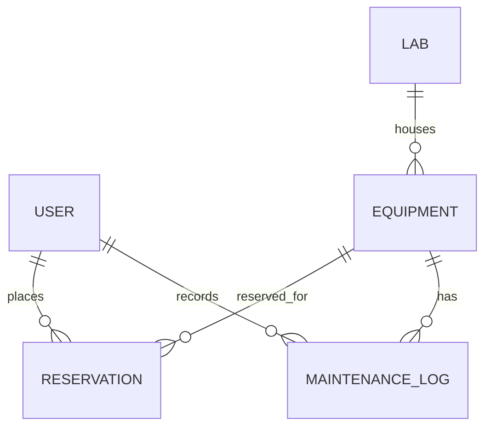
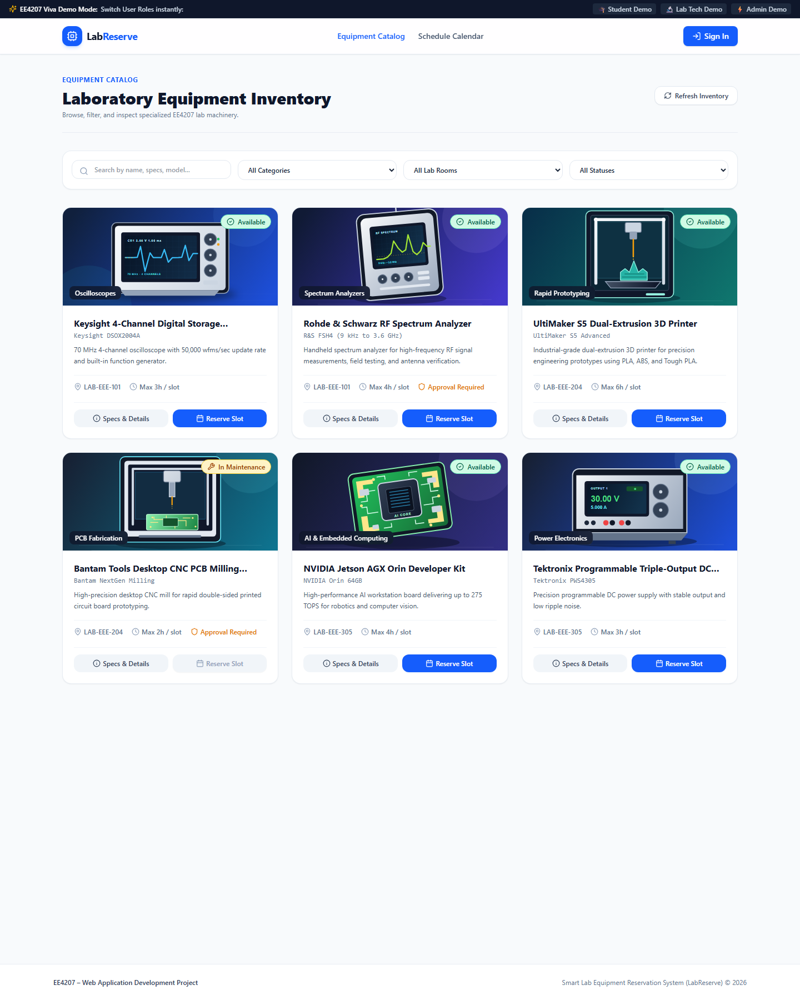
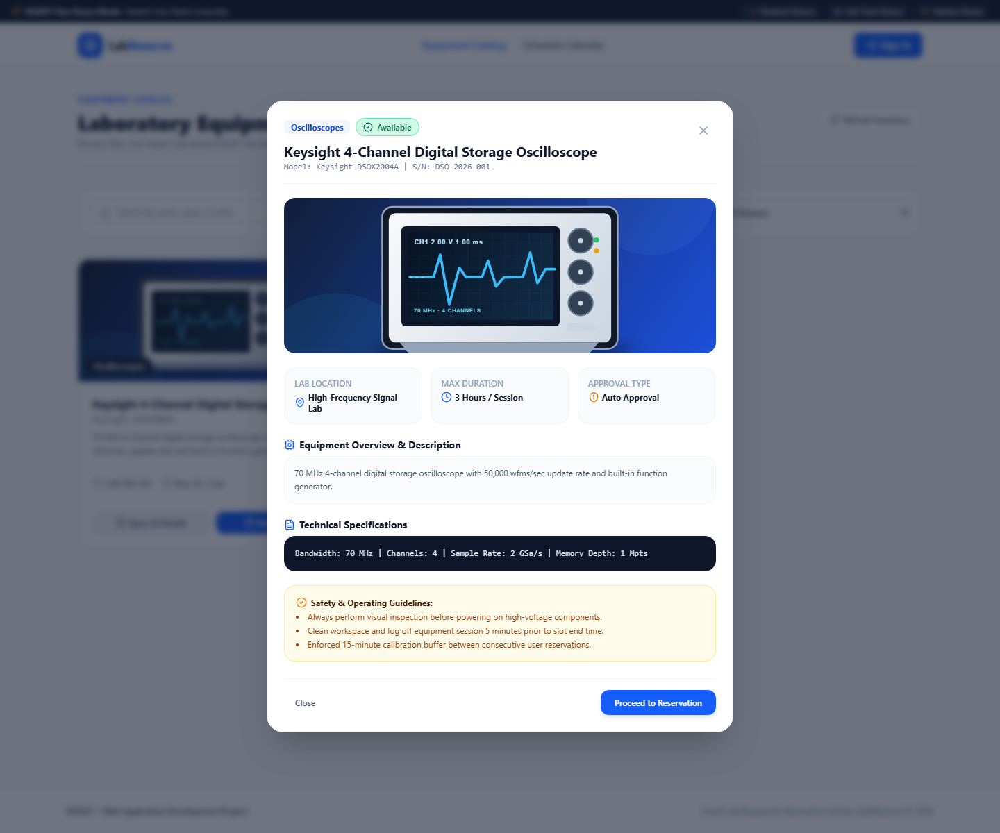

# EE4207 – Web Application Development
## Smart Lab Equipment Reservation System (LabReserve)

LabReserve is a MERN stack web application developed for **EE4207 – Web Application Development**. It automates the scheduling, reservation, approval, and maintenance tracking of specialized university laboratory equipment (Oscilloscopes, 3D Printers, Spectrum Analyzers, and AI Workstations) using MongoDB, Express.js, React, and Node.js.

---

### 🚀 Quick Start Guide (Viva Demonstration)

#### Step 1: Start Backend API Server
Make sure MongoDB is running locally or set `MONGODB_URI` to a MongoDB Atlas connection string. Copy `backend/.env.example` to `backend/.env`, configure the database connection, and replace `JWT_SECRET` with a private random value at least 32 characters long. The backend refuses to start with a missing or weak JWT secret instead of using a built-in fallback.

```bash
cd backend
npm start
```
* The backend API server will run on `http://localhost:5000`.
* MongoDB is automatically seeded with sample lab equipment and 3 pre-configured user accounts when it is empty.
* The old `backend/lab_reserve.json` file is not used by the MERN application; MongoDB is now the source of truth.

#### Step 2: Start Frontend Web Application
```bash
cd frontend
npm run dev
```
* Open your browser at `http://localhost:3000`.

---

### ⚡ 1-Click Viva Demo User Accounts
During the project demonstration/viva, you can click the top banner buttons to instantly log in as any role:

| Role | Demo Email | Password | Access Rights |
| :--- | :--- | :--- | :--- |
| **Student** | `student@university.edu` | `student123` | Browse catalog, check schedule, request reservations, cancel bookings. |
| **Lab Technician** | `tech@university.edu` | `tech123` | Authorize pending requests, flag equipment for maintenance, manage inventory. |
| **Administrator** | `admin@university.edu` | `admin123` | System-wide analytics dashboard, supervisor controls, database reset. |

---

### 🛠️ Key Technical Features
1. **MERN Architecture**: React (Vite) Single Page App + Express RESTful API + MongoDB with Mongoose.
2. **Anti-Collision Scheduling Algorithm**: Real-time slot validation preventing double-bookings and enforcing a mandatory 15-minute calibration buffer.
3. **Role-Based Access Control (RBAC)**: JWT authentication with role enforcement middleware.
4. **Interactive Equipment Catalog**: Real-time search, category filters, lab location filters, and specification sheets.
5. **Supervisor & Admin Portal**: Approval queue for high-value equipment, status management, and utilization analytics.
6. **Offline-ready equipment artwork**: Original, locally bundled SVG illustrations for each seeded equipment type; legacy seeded records also resolve to local artwork without a database reset.

### ✅ CRUD Coverage
Reservations are the main CRUD entity and are stored persistently in MongoDB:

| Operation | How it is demonstrated |
| :--- | :--- |
| **Create** | A student submits a reservation request from the equipment catalog. |
| **Read** | Students view their reservations; technicians and admins review the approval queue and schedule. |
| **Update** | Students edit pending reservation times and purpose; technicians/admins update workflow status. |
| **Delete** | The reservation owner cancels a booking, then permanently deletes the inactive record. |

Pending or approved bookings cannot be permanently deleted, protecting active reservations from accidental removal. Students may edit only their own pending reservations. The API revalidates date ranges, equipment slot limits, and 15-minute collision buffers when a booking is created or edited.

The REST API exposes the reservation CRUD operations at `GET/POST /api/reservations`, `PATCH /api/reservations/:id`, and `DELETE /api/reservations/:id`; workflow status changes use `PATCH /api/reservations/:id/status`. Authentication and ownership checks are applied to reservation operations.

Public account registration creates student accounts only. Technician and administrator access is reserved for accounts provisioned by the system, so a client cannot grant itself elevated permissions by submitting a role field.

Focused CRUD authorization and safety tests can be run with `npm test --prefix backend`; they do not require a live MongoDB instance.

### 🗄️ Database Relationships


Mongoose stores users, equipment, labs, reservations, and maintenance logs in MongoDB. ObjectId references connect related records. See [PROJECT_PROPOSAL.md](./PROJECT_PROPOSAL.md) for the detailed entity relationship diagram and project design.

### 🖼️ Interface Screenshots
These screenshots show the running React application with sample equipment based on the project seed data:





### 📋 Evaluation Submission Checklist
- Submit the GitHub repository link using the course Google Sheet.
- Submit a project report of no more than 10 pages, including interface screenshots.
- Submit a demonstration video of no more than 5 minutes with the camera on.
- Use your index number when naming submission files.
- The rubric lists **31 October 2026** as the deadline.
- A concise report draft is available at [docs/PROJECT_REPORT.md](./docs/PROJECT_REPORT.md); replace its student, index, and repository placeholders before submitting.

---

### 📁 Repository Structure
```
Web Development/
├── PROJECT_PROPOSAL.md        # Technical project proposal submitted for EE4207
├── README.md                  # Quick start guide & viva instructions
├── backend/                   # Node.js + Express REST API
│   ├── src/
│   │   ├── controllers/       # Auth, Equipment, Reservation, Analytics handlers
│   │   ├── middleware/        # JWT & RBAC protection
│   │   ├── models/            # Database schema & seed scripts
│   │   ├── routes/            # REST API endpoints
│   │   ├── utils/             # Collision detection logic
│   │   └── server.js          # Express app entry point
│   └── .env.example           # MongoDB URI and JWT configuration template
└── frontend/                  # React (Vite) SPA
    ├── src/
    │   ├── components/        # Navbar, StatusBadge, EquipmentCard, Modals
    │   ├── context/           # AuthContext for session & viva demo switching
    │   ├── pages/             # Landing, Catalog, Calendar, MyBookings, AdminPortal
    │   └── services/          # Axios API client
```
