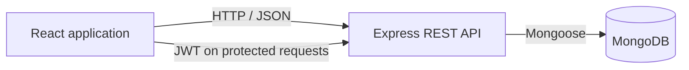
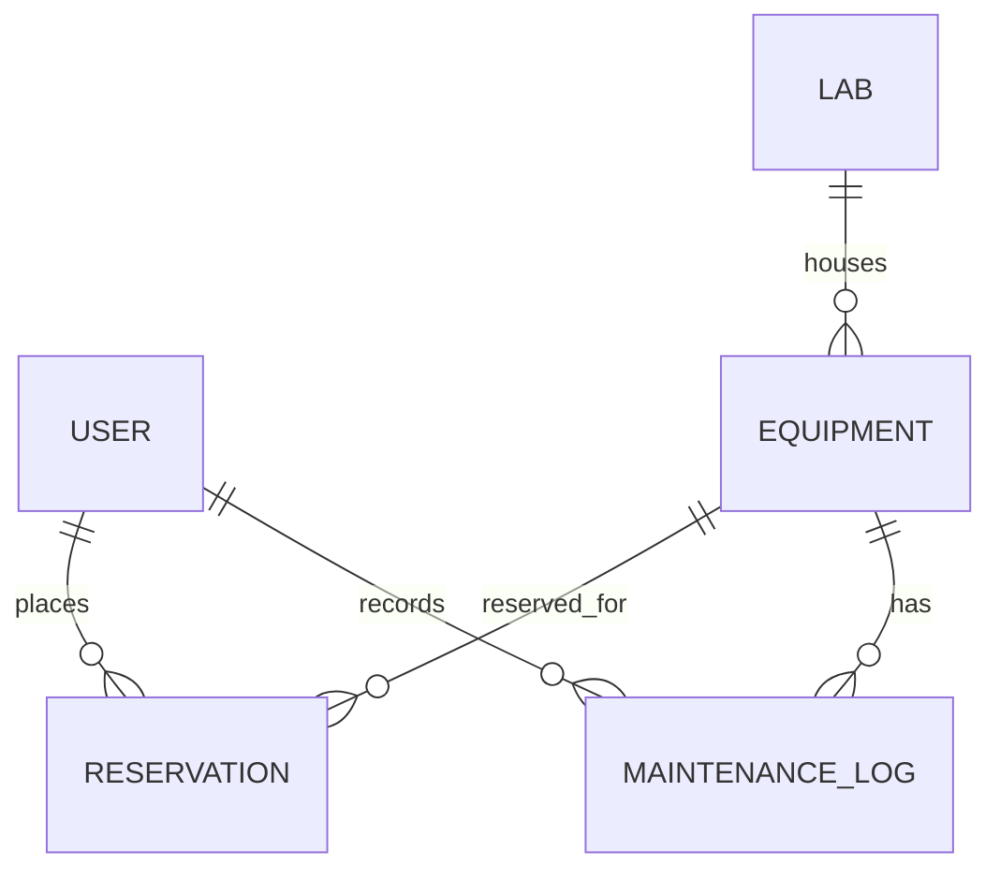

# Smart Lab Equipment Reservation System (LabReserve)

**Module:** EC4307 / EE4207 – Web Application Development  
**Project type:** Mini project  
**Student name:** [Add your name]  
**Index number:** [Add your index number]  
**Repository:** [Add the submitted GitHub repository URL]  
**Report length:** Designed as a concise report within the 10-page limit

## 1. Abstract

LabReserve is a full-stack web application for managing shared university laboratory equipment. Students can browse equipment, view schedules, submit reservation requests, and manage their bookings. Technicians and administrators can review requests, update equipment availability, and view system analytics. MongoDB stores the application records, while an Express REST API provides authenticated operations to a React single-page application.

The system addresses common scheduling problems such as conflicting reservations, limited equipment visibility, manual approval delays, and unreported maintenance. Reservation checks reject past or overlapping time slots and enforce a 15-minute setup/calibration buffer.

## 2. Problem and Objectives

Manual booking methods make it difficult for students to see current equipment availability and for staff to resolve competing requests consistently. LabReserve aims to:

- Provide a searchable, location-aware equipment catalogue.
- Let users request, inspect, edit eligible, cancel, and remove reservation records.
- Prevent booking overlaps and enforce equipment-specific maximum durations.
- Support technician approval for equipment that requires supervision.
- Give lab staff controls for equipment availability and maintenance.
- Store related records persistently in MongoDB.

## 3. Technologies and Architecture

The client uses React, Vite, React Router, Axios, and Tailwind CSS. The server uses Node.js, Express, Mongoose, and JSON Web Tokens; passwords are hashed with bcrypt. MongoDB is the persistent database.

The API is organized into routes, controllers, models, middleware, and scheduling utilities. The frontend separates pages, reusable components, authentication context, and API services.

## 4. Data Model

Users have a name, unique email, password hash, role, and department. Equipment records belong to a lab and store their category, model, serial number, status, approval requirement, and maximum session duration. Reservations reference their owner and equipment and store start/end times, purpose, status, and staff notes. Maintenance logs reference equipment and the technician recording the issue. Mongoose ObjectId references represent the relationships.

## 5. Main Features

### Student

- Browse, search, and filter equipment by category, lab, and status.
- Inspect equipment details and view the reservation calendar.
- Submit reservations with a purpose and requested time.
- Edit the time and purpose of the student's pending request.
- Cancel an active request and permanently delete an inactive reservation record.

### Technician and administrator

- Review and approve or reject pending reservation requests.
- Update equipment availability and maintenance status.
- Review system reservation and equipment analytics.
- Reset the seeded demonstration database as an administrator.

### Reservation validation and access control

The API rejects invalid dates, past reservations, non-increasing time ranges, durations longer than the equipment limit, and conflicts with pending or approved reservations. A 15-minute buffer is checked on both sides of existing reservations. Students can edit or delete only their own eligible records; active reservations cannot be permanently deleted. Public registration creates student accounts only, preventing a registrant from assigning themselves a staff role.

## 6. Functional Architecture and CRUD Implementation

| Requirement Area | LabReserve Technical Implementation |
|---|---|
| Create | Submit persistent reservation records; staff can add equipment. |
| Read | Browse and inspect equipment; view filtered schedules, bookings, and analytics. |
| Update | Edit a pending reservation and update booking status or equipment status. |
| Delete | Permanently remove a cancelled, rejected, or completed reservation after confirmation. |
| Validation and errors | Server-side ID, date, duration, ownership, status, and collision checks; user-facing form feedback. |
| Database design | MongoDB/Mongoose models with ObjectId references and unique email/serial identifiers. |
| UI/UX | Responsive React pages, reusable components, filters, forms, and role-aware navigation. |
| Code quality | Separated client/server modules, reusable API client, and focused automated backend tests. |
| Documentation | Setup instructions, database relationships, feature description, and interface screenshots in this repository. |

## 7. Setup and Demonstration

1. Install Node.js and run `npm run install:all` from the repository root.
2. Ensure MongoDB is available locally or configure a MongoDB Atlas URI.
3. Copy `backend/.env.example` to `backend/.env`, then set `MONGODB_URI` and a private, random `JWT_SECRET`.
4. Start the server with `npm start` in `backend`.
5. In another terminal, run `npm run dev` in `frontend`, then open `http://localhost:3000`.
6. Use the seeded student, technician, and administrator accounts listed in the README for demonstration.
7. Demonstrate a booking, an overlapping booking rejection, a pending request edit, staff approval, equipment maintenance, and safe removal of an inactive reservation.

Run the focused safety tests with `npm test --prefix backend`. Build the production frontend with `npm run build --prefix frontend`.

## 8. Interface Evidence
 
The following screenshots demonstrate the application interfaces captured live for each role:
 
### 8.1 Student Role Interfaces
- **Equipment Catalogue & Filtering:** Shows real-time search, category filtering, and apparatus availability status.
  

- **8:00 AM – 4:00 PM Reservation Modal:** Shows operational time window enforcement, duration limits, and 15-minute buffer conflict visualization.
  

- **Student Personal Dashboard (My Reservations):** Shows active reservation tracking, pending vs approved status badges, inline edit, and cancellation controls.
  

### 8.2 Lab Technician Role Interface
- **Supervisor Approval Queue:** Shows pending student requests requiring staff authorization with declared academic purposes and Approve/Reject actions.
  

### 8.3 Administrator Role Interface
- **Lab Management Console & System Analytics:** Shows real-time equipment utilization rates, pending approval counts, active assets, and viva database reset tool.
  

- **Equipment Inventory Status & Maintenance Controls:** Shows hardware status management controls (Available, Maintenance, Out of Order).
  

### 8.4 Cross-Role Visual Schedule Calendar
- **Interactive Timeline Calendar:** Unified schedule view across all lab equipment with 15-minute cooldown buffers.
  

## 9. Conclusion and Future Work

LabReserve provides a robust, persistent equipment reservation workflow with role-aware staff controls, automated approval pipelines, and collision prevention. The implementation and automated test suites thoroughly verify CRUD safety, authentication boundaries, and reservation ownership. Future enhancements can incorporate automated email notifications, live IoT occupancy tracking, and exportable CSV laboratory utilization reports.
